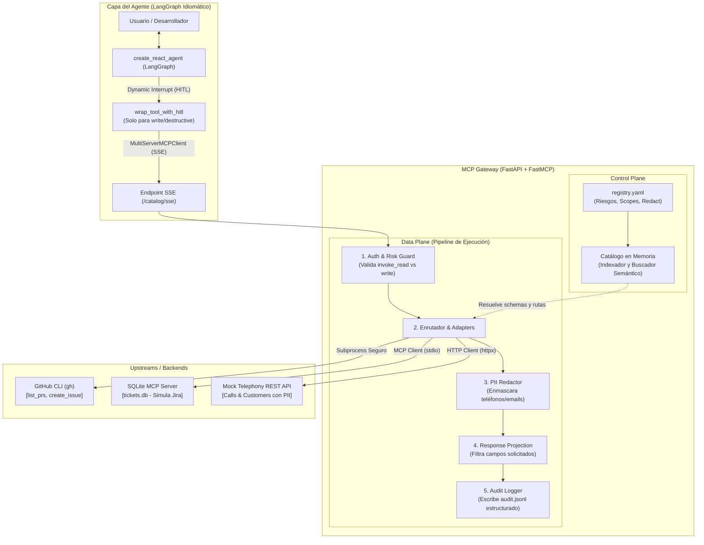

# Plan de Proyecto: MCP Gateway Local con LangGraph (Definitivo)

## 0. Introducción "Big Picture": ¿Qué construimos y por qué?

### La analogía del Restaurante Corporativo
Cuando construimos agentes de IA en una empresa sin un gateway, cada agente es como un cliente que entra directo a la cocina del restaurante:
- Tiene que saber dónde está cada ingrediente y abrir cada heladera por su cuenta (instalar y configurar 10 CLIs, tokens y SDKs en su laptop).
- No tiene supervisión: si quiere usar un cuchillo de carnicero para pelar una manzana, nadie lo frena (permisos excesivos en sus credenciales).
- Si derrama algo o se lleva un secreto, nadie se entera porque no hay cámaras (cero auditoría).
- Y para colmo, tiene que memorizarse de memoria la receta y ubicación de los 500 ingredientes antes de sentarse a la mesa (context window inflado con cientos de schemas de tools).

**El MCP Gateway es el "Maitre + Mozo Seguro" del restaurante:**
El agente no entra a la cocina ni toca las heladeras. Se sienta a la mesa y solo interactúa con un mozo que le ofrece una carta dinámica de 5 opciones fijas. Si el agente pide ver datos de un cliente o crear un issue, el mozo:
1. Verifica si el agente tiene permiso para esa mesa (**AuthZ & Risk Guard**).
2. Va a la cocina, usa la llave del restaurante (**Vault / Token Exchange**) y ejecuta la acción.
3. Si la respuesta contiene datos sensibles como tarjetas o teléfonos, los tapa con una servilleta (**PII Redaction**).
4. Si el agente solo quería saber el precio del plato, no le trae la lista de ingredientes (**Response Projection**).
5. Anota todo en la libreta del restaurante (**Auditoría centralizada**).

Este proyecto implementa **exactamente esta arquitectura enterprise** en tu máquina local, conectando un agente idiomático de **LangGraph** (`create_react_agent` + `MultiServerMCPClient`) con un Gateway en **FastAPI + FastMCP**, abstrayendo la CLI de GitHub, un SQLite MCP (que simula Jira) y una API REST interna.

---

## 1. Matriz de Problemas Resueltos: Uber / PhoneCentral vs. Este PoC

| # | Problema Real (Uber / PhoneCentral) | Causa Raíz sin Gateway | Cómo lo resuelve este PoC Local | Demostración en el PoC |
|---|---|---|---|---|
| **P1** | **Setup frágil (Developer Friction)** | Cada laptop debe instalar y autenticar `gh`, tokens de Jira, SDKs de GCP, etc. | **1 sola URL y 1 sola conexión**: El agente LangGraph solo conoce `http://localhost:8000/catalog/sse`. | El agente funciona sin que LangGraph tenga tokens de GitHub ni conexión a SQLite. |
| **P2** | **Riesgo de seguridad / AuthZ permisivo** | El agente usa credenciales de dev con permisos amplios (puede borrar DBs o repos). | **Separación de riesgos por diseño**: Clasificación en YAML (`read`, `write`, `destructive`). El Gateway rechaza si hay discordancia. | Si el agente llama `invoke_read` sobre `create_issue`, el Gateway devuelve HTTP 403 Forbidden. |
| **P3** | **Cero auditoría y métricas** | Las llamadas van directo de la laptop al servicio; nadie sabe qué hizo el agente. | **Punto de control común**: Cada request pasa por un middleware de auditoría estructurada. | Archivo `audit.jsonl` con: timestamp, agente, tool, parámetros (sin PII), duración y bytes. |
| **P4** | **PII cruda al modelo** | Logs y DBs viajan con teléfonos, emails o datos privados al LLM en la nube. | **Data Redaction en vuelo**: El Gateway enmascara campos sensibles declarados en el YAML antes de responder. | `+14155552671` se transforma en `+1415****671` antes de que el LLM lo lea. |
| **P5** | **Fragmentación (muchos caminos)** | Un equipo usa CLI, otro un script `curl`, otro un SDK. Formatos dispares. | **Interfaz unificada**: Todo se accede como tool de catálogo dinámico bajo el mismo protocolo MCP. | Consultar GitHub, SQLite o la API interna se hace con la misma sintaxis `invoke_*`. |
| **P6** | **APIs internas sin tools** | Exponer una API propia a los agentes requiere programar un MCP server de cero. | **Declarative HTTP Mapping**: Convertir endpoints REST existentes en tools con 8 líneas de YAML. | La API de telefonía se expone sin escribir ni una línea de código MCP en el backend. |
| **P7** | **Contexto inflado y difícil descubrimiento** | 200 schemas de tools saturan la ventana de contexto al iniciar la sesión. | **Omni MCP ($O(1)$) + Response Projection**: Solo 5 meta-tools fijas + parámetro `fields` para recortar JSONs grandes. | El context window inicial gasta < 1.000 tokens en tools, y un JSON de 20 campos se recorta a solo 2. |

---

## 2. Arquitectura de Componentes



---

## 3. Especificación Técnica

### 3.1. Las 5 Meta-Tools del Catálogo Único
El agente LangGraph **solo conoce y ve estas 5 tools fijas**:

1. **`search_tools(query: str, limit: int = 5) -> str`**  
   Busca por intención semántica/léxica sobre `description` y `name` en el catálogo compilado en memoria.
2. **`get_tool_schema(server: str, tool: str) -> str`**  
   Devuelve el JSON Schema estricto de los argumentos y del retorno de la tool solicitada.
3. **`invoke_read(server: str, tool: str, arguments: dict, fields: list[str] = None) -> str`**  
   Ejecuta operaciones de lectura. Aplica **PII Redaction** y **Response Projection** (recorta campos según `fields`).
4. **`invoke_write(server: str, tool: str, arguments: dict) -> str`**  
   Ejecuta operaciones de modificación. En LangGraph dispara la interrupción interactiva (**Human-in-the-loop**).
5. **`invoke_destructive(server: str, tool: str, arguments: dict) -> str`**  
   Ejecuta operaciones de borrado. Requiere validación de permisos severa en el Gateway.

---

## 4. El Agente LangGraph (Consumidor)

El agente está construido con la arquitectura oficial recomendada:
- **`MultiServerMCPClient` (`langchain-mcp-adapters`)**: Conecta al Gateway por SSE y descubre las 5 meta-tools dinámicamente mediante `client.get_tools()`. El agente **no tiene ninguna tool hardcodeada**.
- **`create_react_agent` (`langgraph.prebuilt`)**: Implementa el ciclo ReAct completo (razonamiento, llamada a tools con `ToolNode`, creación de `ToolMessage` y persistencia con `MemorySaver`).
- **Human-in-the-Loop Selectivo (`interrupt()`)**: En lugar de pausar en todas las tools (`interrupt_before=["tools"]`), envuelve únicamente `invoke_write` e `invoke_destructive` con la función nativa `interrupt()`. Las lecturas (`search_tools`, `get_tool_schema`, `invoke_read`) ejecutan automáticamente sin fricción. La confirmación reanuda el grafo con `Command(resume={"approved": True})`.

---

## 5. Estructura Definitiva del Repositorio

```text
mcp-gateway-poc/
├── PLAN.md                     # Este plan definitivo de arquitectura
├── README.md                   # Guía de inicio rápido y manual de usuario
├── pyproject.toml              # Dependencias fijadas con uv
├── .env.example                # Variables de entorno opcionales para LLMs reales
├── config/
│   └── registry.yaml          # Control plane declarativo (servidores, tools, riesgos, PII)
├── data/
│   └── tickets.db             # Base SQLite con tickets de ingeniería en inglés
├── logs/
│   └── audit.jsonl            # Bitácora inmutable de auditoría generada por el Gateway
├── mock_telephony/
│   └── main.py                # Microservicio FastAPI con datos de llamadas y clientes con PII
├── gateway/
│   ├── models.py              # Modelos Pydantic del Registry
│   ├── server.py              # Servidor FastMCP montado en FastAPI con SSE (/catalog/sse)
│   ├── registry.py            # Parser y validador de registry.yaml
│   ├── catalog.py             # Buscador e índice de las 5 meta-tools
│   ├── adapters/
│   │   ├── base.py            # Clase base abstracta
│   │   ├── cli_adapter.py     # Wrapper de GitHub CLI con mock en memoria
│   │   ├── mcp_adapter.py     # Cliente stdio a sqlite_mcp_server.py
│   │   └── http_adapter.py    # Mapeador HTTP declarativo con fallback
│   └── pipeline/
│       ├── guard.py           # Validador de riesgo (read vs write)
│       ├── redactor.py        # Enmascarador de datos sensibles (PII)
│       ├── projection.py      # Filtro de campos por projection
│       └── audit.py           # Logger de auditoría estructurado
├── agent/
│   ├── tools.py               # Descubrimiento con MultiServerMCPClient y wrap_tool_with_hitl
│   ├── models.py              # Configuración de LLM (Gemini, OpenAI)
│   ├── graph.py               # Agente ReAct oficial con create_react_agent
│   └── cli.py                 # CLI interactiva de consola con Human-in-the-loop
├── scripts/
│   ├── seed_db.py             # Generador de la base de datos de tickets
│   └── sqlite_mcp_server.py   # Servidor FastMCP para SQLite
└── tests/
    ├── test_gateway_core.py             # Pruebas unitarias de catálogo, schemas, guard y audit
    ├── test_redactor_and_projection.py  # Pruebas de PII redaction y response projection
    └── test_e2e_incident_flow.py        # Prueba de fuego de punta a punta por red (SSE + HITL)
```

---

## 6. Estado de Fases de Implementación

- [x] **Fase 1: Entorno, Datos y Servicios de Prueba**  
  Entorno configurado con `uv`. Base `tickets.db` generada. Microservicio `mock_telephony` implementado.
- [x] **Fase 2: Control Plane y Adapters**  
  `registry.yaml` con servidores `github`, `jira_mock` y `telephony_api`. Adapters implementados y probados.
- [x] **Fase 3: Data Plane Enterprise (Redaction, Projection, Audit, Guard)**  
  Filtro de riesgos P2, Redacción de PII P4, Proyección de respuesta P7 y bitácora estructurada P3.
- [x] **Fase 4: Agente Idiomático LangGraph con Human-in-the-Loop**  
  Uso de `MultiServerMCPClient` para descubrimiento dinámico y `create_react_agent` con `interrupt()` selectivo.
- [x] **Fase 5: Validación de Punta a Punta ("The Incident Triage")**  
  Test automatizado `tests/test_e2e_incident_flow.py` ejecutándose sobre HTTP SSE real con 100% de éxito.

